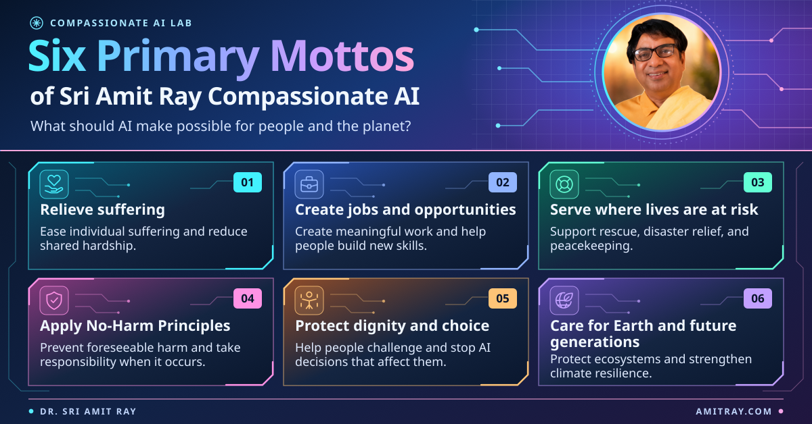

# Compassionate AI Lab

**Founded by Dr. Sri Amit Ray**

We study how to build AI systems that relieve suffering, expand human opportunity, and keep people in control of decisions that affect them. Our work connects **agentic AI reliability**, **Ahimsa and No-Harm Principles**, and the **architecture and alignment of advanced AI systems**.

For an AI agent, these commitments lead to concrete engineering questions. What is the agent authorized to do? What evidence shows that it completed the task? Who can stop it and correct the outcome if something goes wrong?

## Start with a project

| Project | What to explore | Companion code |
| --- | --- | --- |
| [AI Agent Reliability Engineering](https://sriamitray.com/ebooks/ai-agent-reliability-engineering/) | Use mission contracts, the Agentic Reliability Index (ARI), and the offline FlexiAgent lab to evaluate whether agents complete tasks reliably. | [Repository](https://github.com/compassionate-ai-lab/ai-agent-reliability) |
| [No-Harm Principles in AI Architectures](https://sriamitray.com/ebooks/no-harm-principles-in-ai-architectures/) | Work through algorithms and examples for applying No-Harm Principles in multi-agent AI systems. | [Repository](https://github.com/compassionate-ai-lab/no-harm-principles) |
| [Ahimsa in Agentic AI](https://sriamitray.com/ebooks/ahimsa-in-agentic-ai/) | Explore how the principle of non-injury can shape what individual agents are allowed to do. | [Repository](https://github.com/compassionate-ai-lab/ahimsa-in-agentic-ai) |
| [Compassionate Superintelligence](https://sriamitray.com/ebooks/compassionate-superintelligence/) | Explore architecture, alignment, and worked examples for incorporating compassion into increasingly capable AI systems. | [Repository](https://github.com/compassionate-ai-lab/compassionate-superintelligence) |

[Browse all repositories](https://github.com/orgs/compassionate-ai-lab/repositories)

## Six Primary Mottos of Sri Amit Ray Compassionate AI

1. **Relieve suffering.** Expand AI to ease and reduce individual suffering, social suffering, community suffering, and planetary suffering, and help communities reduce shared hardships.
2. **Create more jobs and new opportunities.** Expand AI to create more jobs, foster meaningful work, provide new opportunities for humanity to flourish, and help people build useful skills.
3. **Serve where lives are at risk.** Support disaster response, search and rescue, humanitarian relief, AI assistance for floods and earthquakes, and peacekeeping.
4. **Apply No-Harm Principles.** Prevent foreseeable harm, enhance human safety, stop wars, prevent medical research harms, and take responsibility when harm occurs.
5. **Protect dignity and choice.** Improve human dignity and freedom, giving people the power to understand, challenge, and stop AI decisions that affect their lives.
6. **Care for Earth and future generations.** Protect ecosystems, strengthen climate resilience, and preserve the resources that sustain life.

## Work with the code

Open the relevant repository and follow its setup and test instructions. If you reproduce an example or find a failure case, use the repository's issue tracker where available. Include the example or chapter, the version you ran, the expected result, and what happened. See each repository's license for terms of reuse.

## More from Dr. Sri Amit Ray

[Research and articles at AmitRay.com](https://amitray.com/) · [Books and companion materials at SriAmitRay.com](https://sriamitray.com/)
